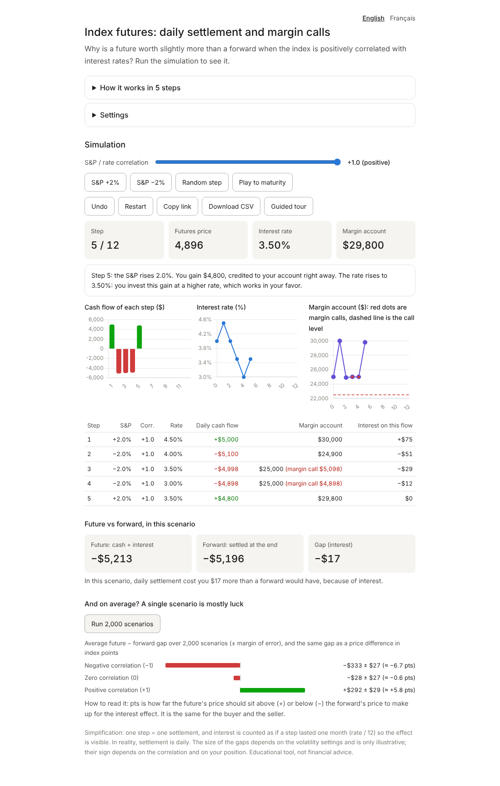

# Futures margin simulator

A small web app that shows **why an index future is worth slightly more or less than a forward**
when the index and interest rates move together.

You buy (or sell) one S&P 500 future and play it step by step. Each step the index moves, the
exchange settles your gain or loss in cash, and you either invest the gain or finance the loss at
the current interest rate. If your margin account gets too low you receive a **margin call**.
At the end, the app compares what you got with what a forward (settled only at the end) would have
given you.



The app is available in English and French (`/?lang=fr`).

## The idea in four lines

- A **forward** is settled once, at maturity. No cash moves before.
- A **future** is settled every day: gains and losses go in or out of your margin account.
- With a **positive correlation** between the index and interest rates, your gains arrive when
  rates are high (you invest them well) and your losses arrive when rates are low (you finance
  them cheaply). So the future is slightly better for the buyer, and its price is slightly
  **higher** than the forward price.
- With a **negative correlation** it is the opposite. With zero correlation there is no
  systematic difference. The seller's side is the exact mirror image.

## Run it

You need Python 3.10 or newer.

```bash
python -m venv .venv
source .venv/bin/activate          # on Windows: .venv\Scripts\activate
pip install -r requirements.txt
python app.py
```

Then open http://127.0.0.1:5000.

For a production-like server:

```bash
gunicorn app:app
```

With Docker:

```bash
docker build -t futures-margin-simulator .
docker run -p 8000:8000 futures-margin-simulator
```

The `Procfile` also works on hosts that read one (Render, Railway, Heroku and similar).

## What you can do in the page

- Play one step at a time (S&P +2%, S&P −2%, or a random step), or play to maturity.
- Choose the correlation between the index and the rate with a slider (−1 to +1).
- Switch between a long (buyer) and a short (seller) position.
- Change the settings: volatility of the index, volatility of the rate, number of steps, initial
  margin and margin call level. Changing a setting restarts the game.
- Undo the last step or restart.
- Follow a guided tour with a quiz question at each of its six stages.
- Copy a link that brings back exactly the same game, or download the table as a CSV file.
- Run 2,000 random scenarios to see the **average** gap between future and forward for a negative,
  a zero and a positive correlation. One scenario is mostly luck; the average shows the effect.

## How the model works

Everything is in `simulator.py`, with plain functions and comments.

- The index starts at 5,000 points and each point is worth $50. The first rate is 4%.
- Each step, the index moves by a percentage (your choice or a random draw), and the exchange
  settles the gain or loss in cash: `cash = (new price − old price) × 50` (the sign flips for a short).
- The rate reacts to the index with the chosen correlation `rho`:
  `rate_shock = rho × index_shock + sqrt(1 − rho²) × noise`, where `noise` is a random draw.
  So with `rho = ±1` the rate follows the index exactly, and with `rho = 0` it moves on its own.
  The rate never goes below 0.
- One step counts as **one month** of interest (rate / 12). Each cash flow earns (gain) or pays
  (loss) simple interest, at the rate of its own step, from that step until the last step played.
- The **gap** is the sum of those interests. A forward has no flows before the end, so its
  result is only the final cash.
- If the margin account falls below the call level (a share of the initial margin), you must top
  it back up to the initial margin: that is the margin call.
- In index points, the price gap is roughly the average gap divided by the point value ($50).
  It is the same for the buyer and the seller.

### Limits of the model

This is a teaching tool, not a pricing model.

- Real settlement is daily; here one step stands for one month of interest so the effect is large
  enough to see. The sizes of the gaps depend on the volatility settings and are only illustrative.
- Interest is simple, not compounded.
- The margin balance itself earns no interest, and you cannot withdraw excess margin.
- The futures price is simply the index level: no cost of carry, dividends or convergence.
- The rate model is deliberately basic (no mean reversion, no term structure).

## Project layout

```
app.py             Flask routes (the page and three JSON endpoints)
simulator.py       The model: plain functions, no framework
translations.py    All texts, in English and French
templates/         The single HTML page
static/app.js      The page logic: buttons, charts, table, tour
static/style.css   Styles (light and dark)
static/vendor/     Chart.js 4.4.1 (MIT), included so the app works offline
tests/             Unit and API tests (pytest)
tests/e2e/         Browser tests (Playwright)
```

The browser keeps the settings and the list of moves. Each time something changes it sends them
to `/api/play`, and the server replays the game and returns the table. The server stores nothing
between requests, which is why a shared link can bring back a game.

### API

| Route | Method | What it does |
|---|---|---|
| `/api/settings` | GET | Default settings, their limits and the fixed values |
| `/api/play` | POST | Replays `{settings, moves}` and returns the rows and the summary |
| `/api/monte-carlo` | POST | Runs `paths` random scenarios (at most 10,000) for correlations −1, 0 and +1 |

Invalid input gets a `400` with a JSON message.

## Tests

```bash
pip install -r requirements-dev.txt
pytest tests --ignore=tests/e2e        # unit and API tests
playwright install chromium            # once, for the browser tests
pytest tests/e2e                       # browser tests
ruff check .                           # lint
```

The browser tests are skipped if Playwright or a browser is missing. To use a Chrome or Chromium
you already have, set `CHROME_PATH` to its location. The same checks run on GitHub Actions
(`.github/workflows/ci.yml`).

## Putting it online

The app has no database and no secrets, so any host that runs a Python or Docker app works.
Before making it public, note that the Monte Carlo endpoint does a little work per request
(about 0.1 s for 2,000 scenarios). The request size and the number of scenarios are capped, but
there is no per-visitor rate limit. If you expect real traffic, add one, for example with
[Flask-Limiter](https://flask-limiter.readthedocs.io/) or at your reverse proxy.

## Disclaimer

An educational tool, not financial advice.

## License

MIT, see `LICENSE`.
# Futures-Margin-Simulator
